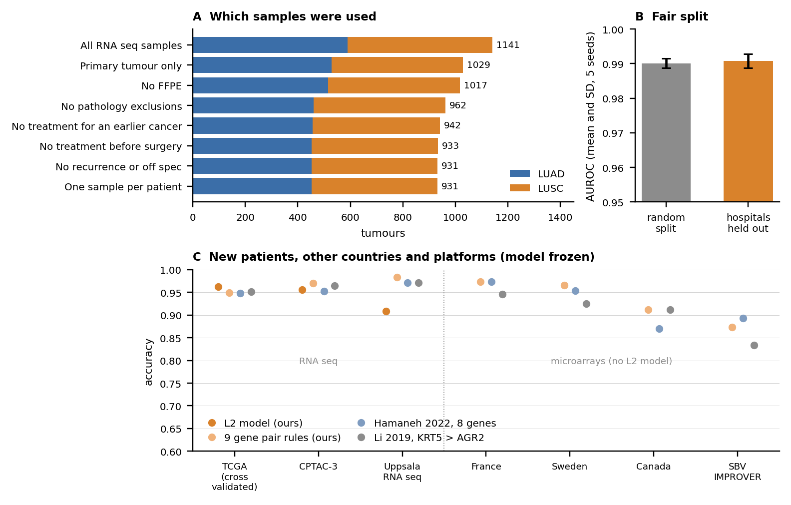
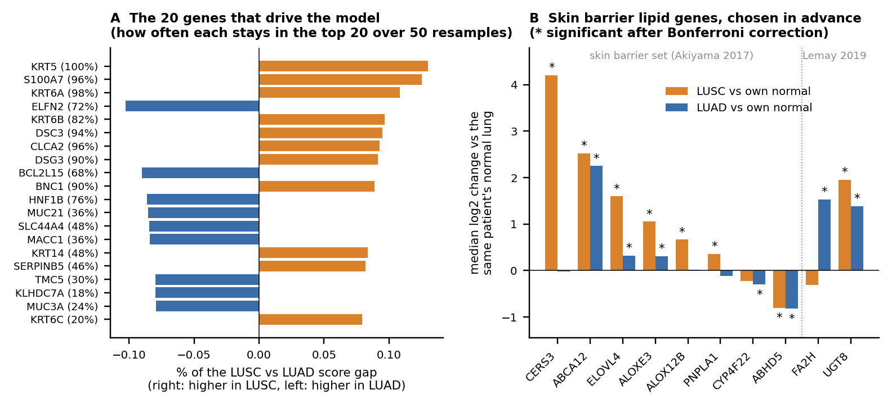
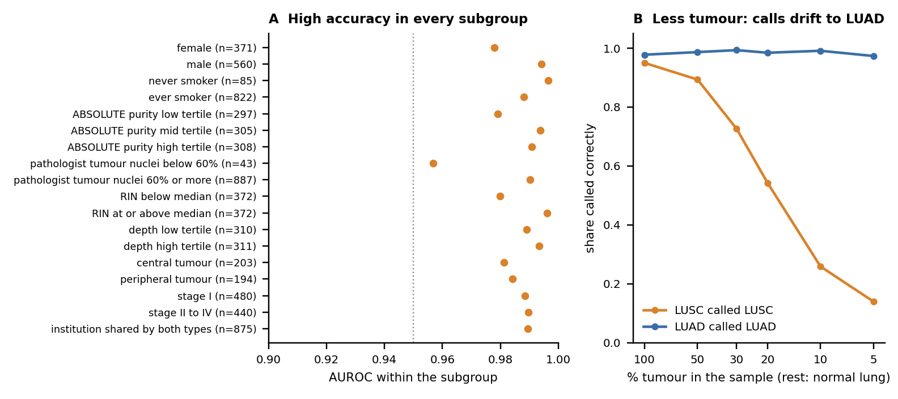

# Squadeno: telling lung adenocarcinoma from lung squamous cell carcinoma with TCGA RNA seq

[](https://github.com/z33shxn/squadeno/actions/workflows/tests.yml)
 

Lung adenocarcinoma (LUAD) and lung squamous cell carcinoma (LUSC) are the two most common lung cancers, and they are treated differently. The name Squadeno joins SQUAmous and ADENOcarcinoma, the two cancers it tells apart. This project builds a classifier that tells them apart from tumour RNA, and then works hard to show that it learned tumour biology and not something else: the hospital a sample came from, how it was stored, its RNA quality, how much tumour was in it, or a wrong label.

Everything here can be rebuilt from public data with one command. Every number in this README and in the [three page write up](report/writeup.pdf) is filled in by the code from the files in `results/`.

## Results at a glance

| Test | Patients | Result |
|---|---|---|
| TCGA, cross validated, hospitals held out (5 seeds) | 931 | AUROC 0.991 ± 0.002, accuracy 96.4% ± 0.1% |
| CPTAC-3 (new patients, same pipeline, model frozen) | 337 | AUROC 0.994, accuracy 95.5% |
| CPTAC-3, Asian patients only | 131 | AUROC 1.000 |
| Uppsala RNA seq (pathologist reviewed labels) | 175 | AUROC 0.988; gene pair rules accuracy 98.3% |
| Four microarray cohorts (France, Sweden, Canada, SBV IMPROVER) | 676 | gene pair rules accuracy 87.3% to 97.3% |
| Korean adenocarcinomas (GSE40419) | 87 | 96.6% called LUAD |
| Shuffled labels (leakage canary) | 931 | AUROC 0.502 (chance, as it should be) |

Against two published classifiers on the same seven cohorts, the nine gene pair rules reach mean accuracy 94.7%, against 93.7% for Hamaneh 2022 and 92.9% for Li 2019. The model matches the best published signature. Its value is in the checks around it.







## What makes this analysis careful

- **Every sample choice comes from the TCGA barcode or an official TCGA table.** Normals, recurrences, FFPE samples, cases the TCGA working group rejected on pathology review, patients treated before surgery or for an earlier cancer, and duplicate samples are removed. Each removed sample and its reason is in `results/excluded_samples.tsv`.
- **The split is grouped by institution.** TCGA gave each site a separate code for each disease, so the site code alone predicts the label perfectly. Holding whole hospitals out of training tests whether the model works somewhere it has never seen.
- **Leakage checks.** Gene filtering and scaling happen inside each training fold. A shuffled label run must score at chance, and it does. A nearest neighbour audit shows that no test tumour's closest training tumour comes from the same hospital.
- **Genes ranked by what drives the call.** Each gene's share of the gap between the model's mean LUSC and LUAD score, so genes that only adjust single samples do not top the list. Each of the top 10 has a short note on what it does and whether it makes sense as a marker, with checked PMIDs.
- **Confounder tests.** Sex, smoking, two independent tumour purity measures, RNA integrity, sequencing depth, tumour location, stage and pre surgery treatment are each tested. DNA mutations are used to check whether disputed cases are label problems.
- **External validation without refitting** in five independent cohorts, plus a Korean cohort, with a head to head comparison against published classifiers.

## Quick start

You need Python 3.12 or newer, about 1 GB of free disk and an internet connection for the first run.

```bash
git clone https://github.com/z33shxn/squadeno
cd squadeno
pip install -r requirements.txt
pip install -e .
python -m squadeno all
pytest
```

`all` downloads the public inputs (about 750 MB; the CPTAC-3 step fetches 337 files one by one and is the slowest, so the first download can take about an hour), then runs every analysis, draws the figures and rebuilds the write up. On a laptop the analyses take about 10 minutes. Each step can also run on its own: `download`, `cohort`, `model`, `genes`, `confounders`, `external`, `figures`, `report`. `python -m squadeno verify` compares your downloaded files with the checksums of the files used for the published results (`data/SHA256SUMS.txt`).

## Score your own samples

```bash
python -m squadeno predict examples/cptac3_six_tumours.tsv
```

The input is a table with gene symbols as rows and samples as columns, holding RNA seq TPM or log2(TPM+1). For each sample you get P(LUSC) from the frozen model, the share of the nine gene pair rules that vote LUSC, the call, and a flag when the model is unsure or the two disagree. The model is stored as plain JSON (`results/final_model.json`) and the rules in `results/rank_rules.json`, so they can be used from any language.

**Research use only.** This is not a medical device and must not be used to make decisions about a patient's care.

## How the analysis works

| Step | Module | What it does |
|---|---|---|
| Data | `download.py`, `cohort.py` | Fetches the inputs and builds the cohort (task part 1) |
| Model | `analysis_model.py` | Nested cross validation grouped by institution, 5 seeds, split comparison, leakage audit, final frozen model (part 2) |
| Genes | `analysis_genes.py` | The 20 genes the model leans on most, their stability, differential expression, the lipid gene set (part 3) |
| Confounders | `analysis_confounders.py` | Six tests of reasons other than tumour biology (part 4) |
| External | `analysis_external.py` | Frozen model on new cohorts and the comparison with published classifiers |
| Report | `report.py`, `figures.py` | Fills the write up and README from `results/` |

## Data sources

All inputs are open access and need no account. They are downloaded by the code and are not stored in this repository.

| Source | What | Reference |
|---|---|---|
| UCSC Xena GDC hub | TCGA LUAD and LUSC STAR expression (TPM, counts) and phenotype tables | Goldman 2020, PMID 32444850 |
| GDC API | TCGA annotations, slide pathology, RNA integrity, aliquot list; CPTAC-3 lung expression | Heath 2021, PMID 33619384 |
| CPTAC-3 lung studies | New patients on the same GDC pipeline (LUAD and LSCC) | Gillette 2020, PMID 32649874; Satpathy 2021, PMID 34358469 |
| GDC PanCanAtlas | Sample quality annotations, ABSOLUTE purity | Hoadley 2018, PMID 29625048 |
| cBioPortal | Tumour location, smoking category, driver mutations and copy number | Gao 2013, PMID 23550210 |
| NCBI GEO | GSE30219 (France), GSE37745 (Sweden), GSE50081 (Canada), GSE43580 (SBV IMPROVER), GSE81089 (Uppsala RNA seq), GSE40419 (Korea) | PMID 23698379, 23032747, 24305008, 23966112, 29282718, 22975805 (in that order) |

## Limitations

- TCGA labels come from one pathology review of each sample and can be wrong; part of the measured error is label error.
- Most TCGA and European patients are white; the Asian checks rest on CPTAC-3 and one Korean cohort.
- The model predicts from gene levels. The lipid finding is about genes, not measured lipids.
- Low tumour content pushes calls toward LUAD; small biopsies were not tested directly.

## Write up, citation and licence

- Write up: [report/writeup.pdf](report/writeup.pdf) (Markdown: [report/writeup.md](report/writeup.md)).
- Cite: see `CITATION.cff`.
- Code licence: MIT. Data remain under the terms of their original sources.

Author: Mohammed Zeeshan. The AI use statement is at the end of the write up.
