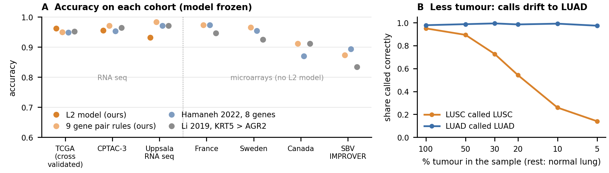

# Telling LUAD from LUSC with TCGA RNA seq, and what the model learned

<small>Mohammed Zeeshan, 28 October 2026. Code, data list and every result: github.com/z33shxn/tcga-luad-lusc-classifier. All numbers below are filled in by the code from the results files.</small>

**In short.** A simple linear model tells LUAD from LUSC with AUROC 0.991 when it is tested on hospitals it never saw. Frozen, it reaches AUROC 0.994 on 337 new CPTAC-3 patients, 131 of them Asian, and nine gene pair rules learned with it hold up on 1,013 new patients in five independent cohorts from other countries and platforms. Its strongest genes are the squamous, skin like programme that pathologists already stain for in LUSC (KRT5, S100A7, KRT6A) and glandular genes plus two new leads in LUAD (ELFN2, BCL2L15, HNF1B). Hospital, sex, smoking, RNA quality and tumour purity do not explain it. DNA changes give only weak support to the idea that some of its rare mistakes are label problems.

## 1. Data: which samples and why

I used the UCSC Xena GDC hub files the email suggested (STAR gene expression as TPM, and the phenotype tables). I checked that Xena's numbers equal the GDC original files: for two tumours I downloaded from GDC, all 60,660 genes matched to machine precision. Every rule below was applied to the TCGA barcode (for example TCGA-55-7726-01A: site 55, patient 7726, sample type 01 = primary tumour, vial A) or to an official TCGA quality table. Each removed sample and its reason is listed in the repository.

| Step | LUAD | LUSC | Total |
|---|---|---|---|
| All RNA seq samples in Xena | 589 | 552 | 1141 |
| Primary tumour only (type 01) | 528 | 501 | 1029 |
| Remove FFPE samples | 516 | 501 | 1017 |
| Remove working group pathology exclusions | 461 | 501 | 962 |
| Remove 'do not use' (treated for an earlier cancer) | 456 | 486 | 942 |
| Remove tumours treated before surgery | 452 | 481 | 933 |
| Remove recurrence or out of specification | 452 | 479 | 931 |
| One sample per patient | 452 | 479 | 931 |

Why each step. Normal tissue (type 11) and recurrences (02) are not the question. FFPE samples have damaged RNA and those patients also have a frozen sample. On review, the TCGA working group called 55 LUAD cases as "NSCLC, not otherwise specified" or "favour large cell neuroendocrine", so their label is not reliable. PanCanAtlas marks 20 patients "do not use" because of treatment for an earlier cancer. GDC notes show 9 tumours were treated before surgery, which changes gene expression, and 2 cases were a recurrence or had results out of specification. The final cohort is **931 tumours (452 LUAD, 479 LUSC), one per patient**, from 38 institutions. For 13 tumours that were sequenced twice, Xena stores the mean of the two runs.

## 2. Model and a split I can defend

**Model.** L2 penalised logistic regression on log2(TPM+1) of 19,938 protein coding genes. The gene filter (expressed in over 20% of training tumours) and the scaling are fitted inside each training fold. Classes are weighted equally. The penalty is chosen by an inner cross validation from four values, and the whole procedure is repeated with five seeds (42, 123, 456, 789, 1337).

**Split.** Five folds grouped by institution: a hospital is either fully in training or fully in testing, and each patient appears once. Why this suits TCGA: the site code in the barcode was issued separately for each disease, so none of the 68 codes is shared by LUAD and LUSC, and the code alone predicts the label 100% of the time. Sequencing plates are almost as pure (6 of 40 contain both types). Institutions, however, are shared (30 of 38 sent both types). Grouping by institution therefore asks the fair question: does the model work at a hospital it has never seen?

| Split (mean ± SD over 5 seeds) | AUROC | AUPRC | Accuracy | Balanced accuracy | Calibration error (ECE) |
|---|---|---|---|---|---|
| Grouped by institution (used) | 0.991 ± 0.002 | 0.992 ± 0.002 | 0.964 ± 0.001 | 0.964 ± 0.001 | 0.011 ± 0.005 |
| Random (for comparison) | 0.990 ± 0.001 | 0.992 ± 0.001 | 0.964 ± 0.002 | 0.964 ± 0.002 | 0.024 ± 0.013 |
| Seed 42, grouped by institution, 95% bootstrap CI | 0.989 (0.982 to 0.994) | 0.990 | 0.962 | 0.963 | 0.009 |
| Nine gene pair rules (learned inside the same folds) | 0.977 | 0.976 | 0.950 | 0.950 | n/a |

Leakage audit, in the style of a residual similarity check. With a random split, the closest training tumour to a test tumour came from the same hospital 8.5% of the time; with my split, 0.0%. On shuffled labels my pipeline scores AUROC 0.502 (chance), while the common mistake of picking genes before splitting scores 0.656. If the least confident 10% are set aside, accuracy rises to 98.1%.

**External tests (model frozen, nothing refitted).** On CPTAC-3 (337 patients, same GDC pipeline; PMID 32649874, 34358469) the model reaches AUROC 0.994 and accuracy 95.5%; in its 131 Asian patients, AUROC 1.000 (TCGA has only 17 Asian patients in this cohort). On Uppsala RNA seq (175 patients; GEO record GSE81089 says a pathologist reviewed the histology again in 2013) it reaches AUROC 0.988, but accuracy only 90.9%: the ranking transfers while the 0.5 cut point drifts on a new pipeline. The nine gene pair rules, which compare genes inside one sample, do not drift: accuracy 98.3% there and 87.3% to 97.3% on four microarray cohorts (France, Sweden, Canada and the SBV IMPROVER set; PMID 23698379, 23032747, 24305008, 23966112). Of 87 Korean adenocarcinomas (GSE40419, PMID 22975805), 96.6% were called LUAD, including 100% of 36 never smokers. Against two published classifiers on the same seven cohorts, my nine gene pair rules average accuracy 94.7% versus 93.7% (Hamaneh 2022, 8 genes, PMID 35722224) and 92.9% (Li 2019, KRT5 > AGR2, PMID 31752667). So the model matches the best published signature; the value of this work is in the checks, not a new record.

## 3. Biology: the 20 genes that drive the classification

For a linear model, the gap between its mean score for LUSC and for LUAD splits exactly into one term per gene: the gene's weight times its difference in mean between the two types (in standard deviations). I rank genes by that term. Ranking by raw weight would instead put CYP27B1, ACTA1 and IGLL1 in the top 10, although they barely differ between the types (single gene AUROC below 0.6); such genes only adjust single samples. "Kept" is how often a gene stays in the top 20 when the model is refitted on 50 resamples (median 70%, against 34% for the raw weight list). The model spreads its weight over 14,845 genes, so these 20 carry only 1.8% of the gap, yet a few genes are enough: the nine gene pair rules reach AUROC 0.977. All 20 also differ strongly in a plain t test (q < 1e-10). On their own, they separate the subtypes in CPTAC-3 too (single gene AUROC 0.849 to 0.982).

| Rank | Gene | Higher in | Share of gap | Kept | AUROC, TCGA | AUROC, CPTAC-3 | log2 change (LUSC vs LUAD) |
|---|---|---|---|---|---|---|---|
| 1 | KRT5 | LUSC | 0.13% | 100% | 0.975 | 0.979 | +8.95 |
| 2 | S100A7 | LUSC | 0.13% | 96% | 0.913 | 0.891 | +4.69 |
| 3 | KRT6A | LUSC | 0.11% | 98% | 0.956 | 0.952 | +7.92 |
| 4 | ELFN2 | LUAD | 0.10% | 72% | 0.851 | 0.849 | -1.61 |
| 5 | KRT6B | LUSC | 0.10% | 82% | 0.959 | 0.950 | +6.33 |
| 6 | DSC3 | LUSC | 0.09% | 94% | 0.971 | 0.982 | +5.78 |
| 7 | CLCA2 | LUSC | 0.09% | 96% | 0.950 | 0.923 | +5.83 |
| 8 | DSG3 | LUSC | 0.09% | 90% | 0.977 | 0.978 | +6.53 |
| 9 | BCL2L15 | LUAD | 0.09% | 68% | 0.938 | 0.956 | -1.94 |
| 10 | BNC1 | LUSC | 0.09% | 90% | 0.958 | 0.975 | +3.93 |
| 11 | HNF1B | LUAD | 0.09% | 76% | 0.971 | 0.960 | -3.23 |
| 12 | MUC21 | LUAD | 0.09% | 36% | 0.898 | 0.918 | -3.67 |
| 13 | SLC44A4 | LUAD | 0.08% | 48% | 0.930 | 0.889 | -3.39 |
| 14 | MACC1 | LUAD | 0.08% | 36% | 0.874 | 0.889 | -1.87 |
| 15 | KRT14 | LUSC | 0.08% | 48% | 0.941 | 0.935 | +6.24 |
| 16 | SERPINB5 | LUSC | 0.08% | 46% | 0.943 | 0.960 | +5.05 |
| 17 | TMC5 | LUAD | 0.08% | 30% | 0.948 | 0.922 | -3.14 |
| 18 | KLHDC7A | LUAD | 0.08% | 18% | 0.883 | 0.865 | -1.89 |
| 19 | MUC3A | LUAD | 0.08% | 24% | 0.892 | 0.873 | -2.15 |
| 20 | KRT6C | LUSC | 0.08% | 20% | 0.958 | 0.919 | +4.33 |

**The top 10, what they do, and whether they make sense as markers.**

- **1. KRT5, higher in LUSC.** Keratin 5 is a structural protein of the basal cells of the skin; when it is faulty, these cells break and the skin blisters (PMID 20030639). Yes, for LUSC. CK5/6 is one of a four stain panel used to subtype lung cancer biopsies (PMID 25120805), and KRT5 with AGR2 separates LUSC from LUAD by staining (PMID 34150027).
- **2. S100A7, higher in LUSC.** S100A7 (psoriasin) is a calcium binding protein made by skin cells that also draws in immune cells (PMID 9693957). Yes, for LUSC. It was reported as a biomarker of lung squamous carcinoma (PMID 25745359).
- **3. KRT6A, higher in LUSC.** Keratin 6A is a keratin that the skin switches on after wounding (PMID 10866680). Yes, for LUSC. It was named as a possible marker that separates LUSC from LUAD in public expression data (PMID 29069744).
- **4. ELFN2, higher in LUAD.** ELFN2 is a cell surface protein that pairs with glutamate receptors at nerve synapses (PMID 33790745). Unclear. Its LUAD pattern is strong here and holds in CPTAC-3, but I found no lung subtyping study.
- **5. KRT6B, higher in LUSC.** Keratin 6B is the second form of keratin 6; it can also be switched on in wounded skin (PMID 10866680). Yes, for LUSC. It was named with KRT6A as a possible marker that separates LUSC from LUAD (PMID 29069744).
- **6. DSC3, higher in LUSC.** Desmocollin 3 is a protein of the desmosome junctions that hold the cells of layered epithelia together (PMID 19287461). Yes, for LUSC. It marks squamous differentiation (PMID 19287461), and a meta analysis lists it among stains for lung squamous carcinoma (PMID 35126682).
- **7. CLCA2, higher in LUSC.** CLCA2 is a protein involved in moving chloride across cell membranes (PMID 25548429). Yes, for LUSC. As a stain it was found in 65% of squamous carcinomas and 1% of adenocarcinomas (PMID 25548429).
- **8. DSG3, higher in LUSC.** Desmoglein 3 is a desmosome protein that glues squamous cells together; it is the target of the autoantibodies in pemphigus (PMID 28492232). Yes, for LUSC. It is a sensitive and specific stain for lung squamous carcinoma (PMID 19342368) and was confirmed by staining tumours (PMID 26380766).
- **9. BCL2L15, higher in LUAD.** BCL2L15 (Bfk) is a weak cell death protein of the BCL2 family (PMID 12700646). Unclear. A PubMed search found no study of BCL2L15 in lung cancer subtyping; its strong, replicated LUAD pattern makes it a new lead, not an established marker.
- **10. BNC1, higher in LUSC.** Basonuclin 1 is a transcription factor of basal epithelial cells and a direct target of p63, the main squamous cell factor (PMID 21741828). Likely, for LUSC. It was among the top genes that separate lung squamous carcinoma from adenocarcinoma in another expression study (PMID 32360590), but I found no study that tests it as a lung stain.

**What the model learned.** The LUSC side is the programme of layered, skin like epithelium: keratins (KRT5, KRT6A, KRT14), desmosome glue (DSG3, DSC3) and BNC1, a basal cell factor that p63 switches on (PMID 21741828). The LUAD side is glandular: mucins (MUC21, MUC3A) and HNF1B, a gene that LUSC switches off by DNA methylation (PMID 29169318, 32117905). This is the split that the standard stain panel captures (p40 and CK5/6 against TTF-1 and Napsin A, PMID 25120805). ELFN2 and BCL2L15 are the exceptions: I found no study of either in lung cancer subtyping, yet both separate the types in CPTAC-3 too (AUROC 0.849 and 0.956). They are new leads, not established markers.

**A lipid view, chosen in advance.** Akiyama 2017 lists the eight genes that build the lipid envelope of the skin barrier (PMID 28623042). I tested exactly that list. Against each patient's own normal lung, LUSC raised 6 of the 8 (CERS3 about 18 fold), but not CYP4F22 or ABHD5. The 8 gene score separates the subtypes in all seven cohorts (AUROC 0.750 to 0.885). LUAD instead raised FA2H, matching Lemay 2019, who measured both this gene and the lipids it makes (PMID 31409741). These are gene levels, not lipid levels; they predict more of the very long chain ceramides of the skin barrier in LUSC, which a lipid lab can measure.

## 4. Could it be something other than tumour biology?

- **Hospital batch.** If the model had learned hospitals, scores would drop when hospitals are held out. They did not: random split 0.990, split by institution 0.991 (difference -0.0006).
- **Non biological variables.** A model built only from sex, age, pack years, two tumour purity measures (DNA based ABSOLUTE and the pathologist's tumour nuclei count), RNA integrity, sequencing depth and tumour location reaches AUROC 0.832, far below the expression model. Much of that is a real difference between the patients: here LUSC patients are more often men (sex alone, AUROC 0.644) and smoked more (pack years, 0.609). Sequencing depth also differs by type (median 44 vs 51 million reads), which is why the model uses TPM, not raw counts.
- **Within every subgroup.** AUROC stays at or above 0.957 in all 18 subgroups: sex, never and ever smokers, each purity tertile, pathologist tumour nuclei below and above 60%, low and high RNA integrity, low and high depth, central and peripheral tumours, early and late stage, and hospitals that sent both types.
- **Treatment before surgery.** Scored by the frozen model, the 9 pre treated tumours were labelled correctly only 67% of the time, against 96.2% in the cohort. This supports removing them.
- **Wrong labels.** For 35 tumours the model and the label disagree. If the label is the problem, their DNA should carry the other subtype's changes (for LUAD, changes such as KRAS, EGFR or STK11 mutation or NKX2-1 gain, PMID 25079552; for LUSC, SOX2, FGFR1 or TP63 gain or PTEN, KMT2D or NFE2L2 mutation, PMID 22960745). Only weakly. In both directions the disputed tumours carry the other subtype's changes more often ("LUSC" called LUAD: 6 of 25 disputed vs 62 of 447 agreed, odds ratio 2.0, p = 0.15; "LUAD" called LUSC: 4 of 10 disputed vs 59 of 438 agreed, odds ratio 4.3, p = 0.039), but neither difference holds after correcting for the two tests. TCGA's own rules allow up to 5% adenocarcinoma inside a squamous sample (GDC lung quality control form).
- **Little tumour in the sample.** Normal lung looks glandular, so dilution pushes calls toward LUAD. In real tumours with purity below 0.25, LUSC was called correctly 80% of the time against 98% for LUAD. When I mixed test tumours with held out normal lung down to 10% tumour, LUSC recall fell to 26% while LUAD stayed at 99%. In Korean data, 97% of normal lungs were called LUAD.

<small>**Figure 1.** A: accuracy with the model frozen. The L2 model needs RNA seq, so the four microarray cohorts are scored by the gene pair rules and the two published classifiers. B: test tumours mixed in silico with held out normal lung; as the tumour share falls, LUSC calls drift to LUAD.</small>

## 5. Clinic and bench

**Why the subtype matters.** Pathologists looking at H&E slides alone agree only moderately on squamous versus non squamous (kappa 0.55, PMID 22583114), and in small biopsies many tumours stay "not otherwise specified" until stains are added (stains resolved 73% with 86% accuracy, PMID 20195168). The label changes treatment. Pemetrexed helped adenocarcinoma (12.6 vs 10.9 months) but did worse than gemcitabine in squamous cancer (9.4 vs 10.8 months; PMID 18506025). Bevacizumab caused major lung bleeding linked to squamous histology, so squamous patients were excluded from its pivotal trial (PMID 15169807, 17167137). Immunotherapy combinations are tested separately: pembrolizumab with pemetrexed for non squamous disease (PMID 29658856) and with paclitaxel for squamous disease (PMID 30280635). Guidelines ask for EGFR, ALK, ROS1 and other gene tests in adenocarcinoma (PMID 29355391); in Asia, about 80% of adenocarcinomas carry a targetable change (PMID 39615406). Calling a Korean adenocarcinoma squamous can therefore hide a targeted drug, and calling a squamous cancer adenocarcinoma can lead to pemetrexed or bevacizumab.

**A wet lab test of the top markers.** The top two genes, KRT5 and S100A7, are both higher in LUSC, so I would add the top LUAD gene, ELFN2, to give each type a positive stain. KRT5 is already stained in practice as part of CK5/6 (PMID 25120805), so it doubles as a check that the method works. I would stain all three by immunohistochemistry on tissue microarrays of resected lung cancers (two or three cores per tumour; core sampling is reliable for lineage stains in NSCLC, PMID 24486059), with p40 and TTF-1 on serial sections as the reference (p40 is 100% sensitive and 98% specific for squamous carcinoma, PMID 22056955). Tissue would come from a hospital archive such as Gachon University Gil Medical Center, whose pathology department has published stain and FISH work on resected NSCLC (PMID 22207554), under ethics approval. I would enrich for the hard cases: TTF-1 negative adenocarcinomas (about 28% of adenocarcinomas, PMID 12023581), solid and poorly differentiated tumours, and cases first called "not otherwise specified". Two pathologists, blind to the RNA result and to each other, would give H scores to tumour cells only, ignoring normal airway and immune cells. I would report sensitivity, specificity and AUROC against the final diagnosis, agreement as Cohen's kappa, and McNemar's test against p40 and TTF-1, with the sample size set for the expected sensitivity (PMID 24582925). Matched frozen tissue could add a measurement of very long chain ceramides by liquid chromatography mass spectrometry, the kind of ceramide work this lab already does (PMID 35513574).

**Limits.** The labels come from one pathology review per tumour, so part of the measured error is label error. Most TCGA and European patients are white; the Asian checks rest on CPTAC-3 and one Korean cohort. I tested resected tumours, not small biopsies, and low tumour content pushes calls toward LUAD, so biopsies need their own test before any clinical use.

**Reproduce.** `pip install -e .` then `python -m luadlusc all` downloads the public data, reruns every analysis and rebuilds this document.

## AI use

I used an AI assistant (Claude, Anthropic) throughout this project: to draft and debug the code, to propose and run analyses that I then reviewed, to search PubMed and check that each PMID exists and supports its claim, and to edit the English. I directed the work, made the analysis decisions, reviewed the results and the claims, and take responsibility for the content.
